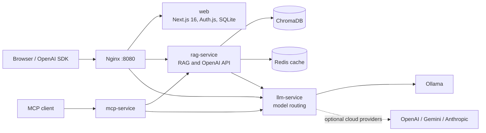
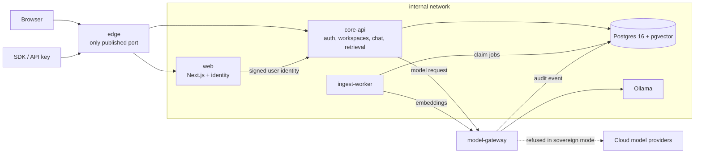

# Architecture

LLM Dev Kit is evolving from the runnable v1 Compose stack to the v3 secure,
workspace-aware architecture. Both code paths are in this repository, but only
the v1 stack is currently wired into `docker-compose.yml`. The distinction is
intentional: do not deploy the v3 services until roadmap step g supplies the
v3 Compose profile, secrets, network isolation, and end-to-end tests.

| | Current runnable stack (v1) | v3 target |
| --- | --- | --- |
| Entry point | Nginx on `:8080` | Edge proxy, the only published port |
| Chat and retrieval | `rag-service` + Redis + Chroma | `core-api` + Postgres/pgvector |
| Model access | `llm-service` | `model-gateway`, the only model caller |
| Ingestion | HTTP path in `rag-service` | `ingest-worker` over a Postgres job queue |
| Identity and tenancy | Auth.js, per-user chat history in SQLite | Signed identity plus workspace-scoped access in Postgres |
| Network policy | Compose default network | Internal network; model gateway is the controlled egress point |

## Current runnable stack (v1)

`docker compose up` starts the following architecture. Nginx is the only
published service and binds to `127.0.0.1:8080` unless `GATEWAY_BIND` is set.

### Routing

| Public path | Upstream |
| --- | --- |
| `/` and web-owned `/api/*` routes | `web` |
| `/v1/*` and `/api/rag/*` | `rag-service` |
| `/api/llm/*` | `llm-service` |
| `/sso/*` with the SSO profile | Keycloak |

Nginx disables proxy buffering for streaming responses. It shows a startup page
when the `web` container is unavailable. Only `/v1/*`, `/api/rag/*` and
`/api/llm/*` keep real upstream status codes. The web app's own `/api/*` routes
share the catch-all `location /`, so a failed web response there is currently
rewritten to a `200` page ([#92](https://github.com/sameeralam3127/llm-dev-kit/issues/92)).

## Known limits of the v1 stack

Found in the 2026-11-14 review and each tracked by an issue. None is fixed yet.
"Reproduced" means observed on a running stack; "in code" means established by
reading the source.

| Limit | Status | Issue |
| --- | --- | --- |
| State lives in three places: SQLite (users, chats, keys, audit, upload jobs), Chroma (the document index) and Redis (a disposable answer cache). Nothing backs them up or restores them together | In code | [#89](https://github.com/sameeralam3127/llm-dev-kit/issues/89) |
| One shared document index: separation between users ends before retrieval. This is stated in the README, and is by design until workspaces arrive in v3 | In code | [#15](https://github.com/sameeralam3127/llm-dev-kit/issues/15) |
| Concurrent sends to one chat fail with `500` and the message is lost (a transaction times out under SQLite). Message positions are also not a database invariant | **Reproduced** (2, 3, 5 and 10 simultaneous sends) | [#82](https://github.com/sameeralam3127/llm-dev-kit/issues/82) |
| The answer cache is keyed by question and model only, with no document revision. Only the admin "clear cache" action invalidates it, and an upload through the API does not | In code | [#6](https://github.com/sameeralam3127/llm-dev-kit/issues/6) |
| The web app's failed API calls look like `200` pages at the gateway | In code | [#92](https://github.com/sameeralam3127/llm-dev-kit/issues/92) |
| Invalid API keys share, and can exhaust, the token-exchange limit | In code | [#93](https://github.com/sameeralam3127/llm-dev-kit/issues/93) |
| A failed `/v1` stream reports its error as ordinary text followed by a normal stop marker | In code | [#81](https://github.com/sameeralam3127/llm-dev-kit/issues/81) |
| `ALLOW_LEGACY_ANONYMOUS` makes unauthenticated callers administrators when set | In code | [#88](https://github.com/sameeralam3127/llm-dev-kit/issues/88) |
| Plugins run inside their host service, with its permissions. Their manifests are disclosure, not a sandbox | Documented; no issue tracks isolation. The marketplace in [#18](https://github.com/sameeralam3127/llm-dev-kit/issues/18) is deferred until it exists | None |
| Model access is not forced through one gateway in v1, so sovereign mode cannot be enforced there | In code | [#13](https://github.com/sameeralam3127/llm-dev-kit/issues/13) |

The v3 target below removes the first, second, fourth and last rows by design:
one system of record, workspace-scoped retrieval, no shared answer cache, and a
mandatory model gateway. It does not remove the need for the database to
enforce message ordering, so [#82](https://github.com/sameeralam3127/llm-dev-kit/issues/82)
applies there too.

## v3 target architecture

The v3 services and their migrations are implemented in the repository, but
they are not yet in the default Compose file. Their contract is defined in
[the v3 roadmap](docs/v3/ROADMAP.md).

### v3 responsibilities

- **core-api** authenticates sessions and workspace API keys, resolves every
  request to user, workspace, and scopes, performs hybrid retrieval, and
  serves `/v1/models` and `/v1/chat/completions` over SSE.
- **ingest-worker** claims Postgres jobs with `FOR UPDATE SKIP LOCKED`, parses
  PDFs, chunks them, requests embeddings, and atomically replaces a document's
  chunks.
- **model-gateway** authenticates internal callers, applies sovereign-mode
  egress rules before a model request, and records each permitted request in
  the audit log.
- **Postgres with pgvector** is the system of record for workspaces, API keys,
  documents, jobs, chunks, provenance, and audit events. Retrieval filters by
  `workspace_id` in SQL.

## Operational boundaries

- Every currently public endpoint goes through Nginx; backend data services
  are not published as host ports.
- v3 makes authentication and workspace authorization mandatory for `/api/*`
  and `/v1/*`. A personal workspace API key is stored as a prefix plus a
  server-peppered HMAC, never plaintext.
- `SOVEREIGN_MODE=true` is the v3 default. It prevents cloud providers and
  Ollama cloud-model identifiers before any prompt can leave the network.
- The v3 Compose profile will run internal containers on an `internal: true`
  network and use Docker secrets, read-only filesystems, healthchecks, image
  scanning, and an SBOM before it is considered deployable.
