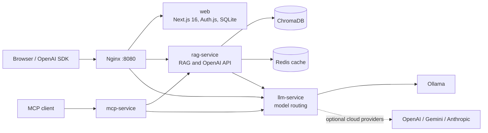
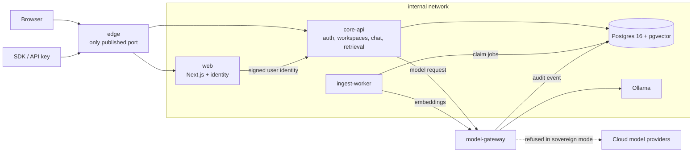

# Architecture

LLM Dev Kit is evolving from the runnable v1 Compose stack to the v3 secure,
workspace-aware architecture. Both code paths are in this repository, but only
the v1 stack is currently wired into `docker-compose.yml`. The distinction is
intentional: do not deploy the v3 services until roadmap step g supplies the
v3 Compose profile, secrets, network isolation, and end-to-end tests.

| | Current runnable stack (v1) | v3 target |
| --- | --- | --- |
| Entry point | Nginx on `:8080` | Edge proxy, the only published port |
| Chat and retrieval | `rag-service` + Redis + Chroma | `core-api` + Postgres/pgvector |
| Model access | `llm-service` | `model-gateway`, the only model caller |
| Ingestion | HTTP path in `rag-service` | `ingest-worker` over a Postgres job queue |
| Identity and tenancy | Auth.js, per-user chat history in SQLite | Signed identity plus workspace-scoped access in Postgres |
| Network policy | Compose default network | Internal network; model gateway is the controlled egress point |

## Current runnable stack (v1)

`docker compose up` starts the following architecture. Nginx is the only
published service and binds to `127.0.0.1:8080` unless `GATEWAY_BIND` is set.



### Routing

| Public path | Upstream |
| --- | --- |
| `/` and web-owned `/api/*` routes | `web` |
| `/v1/*` and `/api/rag/*` | `rag-service` |
| `/api/llm/*` | `llm-service` |
| `/sso/*` with the SSO profile | Keycloak |

Nginx disables proxy buffering for streaming responses. Its frontend-only
startup page handles a temporarily unavailable `web` container; API routes
retain their real upstream status codes.

### Current services

- **web** is the Next.js 16 application. It provides Auth.js sessions,
  accounts, chat history, folders, sharing, and the admin UI. It signs the
  short-lived RS256 tokens consumed by the Python services.
- **rag-service** retrieves PDF context from Chroma, streams answers, and
  provides the OpenAI-compatible API.
- **llm-service** routes local Ollama and optional LiteLLM cloud models. It is
  the v1 model and embedding client.
- **mcp-service** exposes `list_models` and `ask_llm_dev_kit` over stdio and
  calls the two Python services over HTTP.
- **Redis** stores cached answers; **Chroma** stores PDF vectors; **Ollama** is
  local by default.

The web frontend's production dependencies are maintained with
`npm audit --omit=dev`; issue #75 upgraded Next.js and Zod so the high/critical
production audit is clean on the `v3` branch.

## v3 target architecture

The v3 services and their migrations are implemented in the repository, but
they are not yet in the default Compose file. Their contract is defined in
[the v3 roadmap](docs/v3/ROADMAP.md).



### v3 responsibilities

- **core-api** authenticates sessions and workspace API keys, resolves every
  request to user, workspace, and scopes, performs hybrid retrieval, and
  serves `/v1/models` and `/v1/chat/completions` over SSE.
- **ingest-worker** claims Postgres jobs with `FOR UPDATE SKIP LOCKED`, parses
  PDFs, chunks them, requests embeddings, and atomically replaces a document's
  chunks.
- **model-gateway** authenticates internal callers, applies sovereign-mode
  egress rules before a model request, and records each permitted request in
  the audit log.
- **Postgres with pgvector** is the system of record for workspaces, API keys,
  documents, jobs, chunks, provenance, and audit events. Retrieval filters by
  `workspace_id` in SQL.

## Operational boundaries

- Every currently public endpoint goes through Nginx; backend data services
  are not published as host ports.
- v3 makes authentication and workspace authorization mandatory for `/api/*`
  and `/v1/*`. A personal workspace API key is stored as a prefix plus a
  server-peppered HMAC, never plaintext.
- `SOVEREIGN_MODE=true` is the v3 default. It prevents cloud providers and
  Ollama cloud-model identifiers before any prompt can leave the network.
- The v3 Compose profile will run internal containers on an `internal: true`
  network and use Docker secrets, read-only filesystems, healthchecks, image
  scanning, and an SBOM before it is considered deployable.

## Development and verification

The current web checks are:

```sh
cd web
npm run typecheck
npm test -- --run
npm run lint
npm run build
npm audit --omit=dev --audit-level=high
```

Run Python tests from an environment that installs the repository's development
requirements, including the PostgreSQL driver. The completed v3 stack will add
a fresh-clone Compose smoke test covering account creation, document upload,
grounded chat with citations, and sovereign-mode egress blocking.
