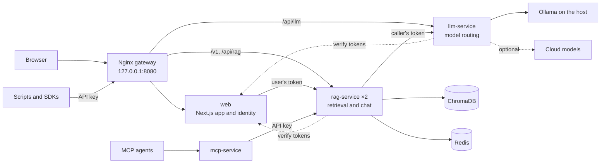

<div align="center">

# LLM Dev Kit

**A private AI workspace for your team. Chat with your documents on your own hardware.**

Ask questions in plain language and get answers grounded in your own PDFs,
from models that run on your machine. Bring in your team with accounts, roles
and single sign-on. Connect your scripts, notebooks and agents through an
OpenAI-compatible API and MCP.

[](LICENSE)


[Quick start](#quick-start) · [Tour](#a-quick-tour) · [Features](#features) · [Use it from code](#use-it-from-code) · [Architecture](#how-it-works) · [Docs](#documentation)

<br>

<picture>
  <source media="(prefers-color-scheme: dark)" srcset="docs/images/chat-dark.jpg">
  
</picture>

</div>

---

## Why LLM Dev Kit

- **Private by default.** Chat and embeddings run on [Ollama](https://ollama.com)
  on your own machine. Nothing leaves it unless you choose a cloud model.
- **Answers you can check.** Upload PDFs and every answer is grounded in the
  passages it retrieves from them. When the documents do not cover a
  question, the assistant says so rather than inventing an answer.
- **Ready for a team.** Accounts, roles (admin, user, viewer), personal API
  keys, optional Keycloak single sign-on, and an admin console for people,
  keys, documents and service health.
- **Open at every seam.** An OpenAI-compatible `/v1` API works with any OpenAI
  SDK and with LangChain. An MCP server plugs into Claude Desktop and other
  agents. Model providers, the vector store, loaders and chunkers are plugins
  you can swap.

## Quick start

You need [Docker](https://docs.docker.com/get-docker/) with Compose v2 and
[Ollama](https://ollama.com/download) running on the host.

**1. Pull the models** (once, about 5 GB):

```bash
ollama pull llama3.1
ollama pull nomic-embed-text
```

**2. Configure and start the stack:**

```bash
git clone https://github.com/sameeralam3127/llm-dev-kit.git
cd llm-dev-kit

# Inside Docker, Ollama is reached through host.docker.internal, so drop the
# localhost setting meant for running the services outside Docker.
grep -v '^OLLAMA_HOST=' .env.example > .env
echo "AUTH_SECRET=$(openssl rand -base64 32)" >> .env

docker compose up --build
```

**3. Open <http://localhost:8080> and create an account.** The first account
becomes the admin.

**4. Add a document and ask about it.** As the admin, open the account menu
(bottom left) → **Admin** → **Documents** and drop a PDF onto the page. From a
script, create an API key under account menu → **API keys**, then:

```bash
KEY=sk-ldk-...   # the key you just created
curl -H "Authorization: Bearer $KEY" -F "file=@handbook.pdf" \
  http://localhost:8080/api/rag/ingest/pdf
# {"chunks":12}
```

Ask a question about the document in the chat. The answer comes from the
handbook, generated by llama3.1 on your machine.

> [!TIP]
> Everything listens on `127.0.0.1:8080` only, so nothing is exposed until you
> decide. [docs/usage.md](docs/usage.md) covers inviting a team on your
> network, and [docs/setup.md](docs/setup.md) walks through every step in more
> detail.

## A quick tour

<table>
  <tr>
    <td width="50%">
      
      <p align="center"><b>Start anywhere.</b> Suggested prompts, or just type.</p>
    </td>
    <td width="50%">
      
      <p align="center"><b>Find anything.</b> <kbd>⌘K</kbd> searches every chat, titles and messages.</p>
    </td>
  </tr>
  <tr>
    <td width="50%">
      
      <p align="center"><b>Keys for your tools.</b> Personal API keys, shown once and revocable.</p>
    </td>
    <td width="50%">
      
      <p align="center"><b>Sign in your way.</b> Email and password, GitHub, or your Keycloak.</p>
    </td>
  </tr>
  <tr>
    <td width="50%">
      
      <p align="center"><b>Manage people.</b> Roles per user, with at least one admin always kept.</p>
    </td>
    <td width="50%">
      
      <p align="center"><b>See the system.</b> Health of every service, refreshed every 30 seconds.</p>
    </td>
  </tr>
</table>

## Features

### Chat

- **Streaming answers** with a stop button. A partial answer is saved even if
  you stop it or the model host fails mid-sentence.
- **Edit and regenerate.** Editing a message rewinds the conversation to that
  point. Earlier answers stay one click away through `‹ 2/3 ›`.
- **Organised history.** Chats grouped by date, folders, pinning, and a sidebar
  that collapses to an icon rail.
- **Keyboard first.** <kbd>⌘K</kbd> palette, <kbd>⇧⌘O</kbd> new chat,
  <kbd>⌘B</kbd> sidebar.
- **Readable output.** GitHub-flavoured Markdown, syntax highlighting loaded on
  demand, per-block copy.
- **Sharing.** Publish a chat as a read-only link and revoke it at any time.
- **Accessible.** Light, dark and system themes with WCAG AA contrast, full
  keyboard support, and motion that stops when your system asks for reduced
  motion.

### Knowledge

- **Retrieval-augmented answers** over your PDFs: text is chunked, embedded
  locally with `nomic-embed-text` and stored in ChromaDB.
- **Any model.** Local Ollama models by default. Add a key in `.env` and
  `openai/…`, `gemini/…` and `anthropic/…` models appear in the model picker,
  through [LiteLLM](https://github.com/BerriAI/litellm).
- **Cached answers.** Repeated questions to `/api/rag/chat` come back from Redis
  instantly.

### Identity and access

- **Every API call is authenticated.** The browser uses its session; scripts
  and agents use personal API keys (`sk-ldk-…`, stored hashed, shown once).
- **Roles:** `viewer` chats, `user` also adds documents, `admin` also manages
  people, keys and documents.
- **Admin console** at `/admin`, separate from the chat: an overview with usage
  and service status, users and roles, every API key with revoke, document
  upload and index controls, and health with the instance's configuration.
- **Single sign-on:** `docker compose --profile sso up` adds Keycloak with a
  ready-made realm, served at `/sso`.
- **No account takeover by email.** An external sign-in whose email already has
  an account is refused, not silently linked.
- **Short-lived credentials.** The services verify 5-minute signed tokens
  themselves, so the gateway is never trusted blindly.

### Operations

- **One command, one port.** `docker compose up` starts everything behind an
  Nginx gateway on `127.0.0.1:8080`; no other port is published.
- **Scales out.** rag-service runs two replicas by default; add more with
  `--scale` and the gateway picks them up without a restart.
- **Observable.** Structured JSON logs, one request id that follows a call
  across every service, and one error format everywhere.
- **Gated releases.** CI lints, type-checks, tests and starts every image before
  anything is published.

## Use it from code

The `/v1` API speaks the OpenAI protocol, so existing clients work by changing
two settings. Every answer is grounded in your documents.

**Python (OpenAI SDK)**

```python
from openai import OpenAI

client = OpenAI(base_url="http://localhost:8080/v1", api_key="sk-ldk-...")
reply = client.chat.completions.create(
    model="llama3.1",
    messages=[{"role": "user", "content": "When does BLUEFIN-42 ship?"}],
)
print(reply.choices[0].message.content)
```

**LangChain**

```python
from langchain_openai import ChatOpenAI

llm = ChatOpenAI(base_url="http://localhost:8080/v1", api_key="sk-ldk-...", model="llama3.1")
print(llm.invoke("Summarise the onboarding handbook").content)
```

**curl, with streaming**

```bash
curl -N http://localhost:8080/v1/chat/completions \
  -H "Authorization: Bearer $KEY" -H "Content-Type: application/json" \
  -d '{"model":"llama3.1","stream":true,"messages":[{"role":"user","content":"Hello"}]}'
```

**MCP (Claude Desktop and other agents).** Add [`mcp.json`](mcp.json) to your
client with `LDK_API_KEY` set to an API key. It provides `ask_llm_dev_kit` and
`list_models`.

<details>
<summary><b>All endpoints</b></summary>

All paths go through the gateway at `http://localhost:8080`. Everything except
the health checks needs `Authorization: Bearer <api key>`.

| Method and path | Role | What it does |
| --- | --- | --- |
| `GET /api/rag/health`, `GET /api/llm/health` | none | Liveness; llm-service also reports whether Ollama is ready |
| `GET /v1/models` | viewer | Models, in OpenAI format |
| `POST /v1/chat/completions` | viewer | Grounded chat, streaming or not, in OpenAI format |
| `POST /api/rag/chat` | viewer | Grounded chat with its sources; `"api_key"` in the body uses your own cloud key for that call |
| `POST /api/rag/chat/stream` | viewer | The same, streamed as NDJSON (`meta`, `delta`, `done`) |
| `GET /api/llm/models` | viewer | Local and configured cloud models |
| `POST /api/rag/ingest/pdf` | user | Add a PDF (multipart field `file`, up to 64 MB) |
| `GET /api/rag/documents/stats`, `POST /api/rag/documents/clear` | admin | Count or clear the index |
| `GET /api/rag/cache/stats`, `POST /api/rag/cache/clear` | admin | Inspect or clear cached answers |

Errors share one shape, `{"error": {"code": "...", "message": "..."}}`, with
the status implied by the code: `invalid_request` 400, `unauthorized` 401,
`forbidden` 403, `not_found` 404, `conflict` 409, `rate_limited` 429,
`internal` 500, `upstream_error` 502, `upstream_unavailable` 503, `timeout`
504. Every response carries an `X-Request-ID`; send your own to find a call in
the logs.

</details>

## How it works



| Service | What it does |
| --- | --- |
| `nginx` | The gateway and the only published port. Routes to the app and APIs and balances across rag-service replicas. |
| `web` | The Next.js chat app. It is also the identity service: it signs short-lived tokens and publishes their keys at `/.well-known/jwks.json`. |
| `rag-service` | Retrieval, grounded chat, the `/v1` API, PDF ingestion and the answer cache. Two replicas by default. |
| `llm-service` | One interface to every model: Ollama locally, cloud providers through LiteLLM. |
| `mcp` | An MCP server over stdio for agents (profile `mcp`). |
| `redis`, `chroma` | Cache and vector store, reachable only inside the Compose network. |
| `keycloak` | Optional single sign-on (profile `sso`). |

The Python services never trust the gateway: each verifies the caller's token
itself. [ARCHITECTURE.md](ARCHITECTURE.md) has the request flows and the Docker
build strategy.

## Configuration

Settings live in `.env`; [`.env.example`](.env.example) documents every one.
The ones you are most likely to change:

| Setting | Default | What it is for |
| --- | --- | --- |
| `AUTH_SECRET` | none, required | Signs sessions and encrypts the token signing keys. `openssl rand -base64 32` |
| `WEB_PUBLIC_URL` | `http://localhost:8080` | The address people type into their browser |
| `GATEWAY_BIND` | `127.0.0.1` | Set `0.0.0.0` to let other machines on your network in |
| `ALLOW_REGISTRATION` | `true` | Set `false` once your team has signed up |
| `DEFAULT_CHAT_MODEL` | `llama3.1` | Any model you have pulled in Ollama |
| `OPENAI_API_KEY`, `GEMINI_API_KEY`, `ANTHROPIC_API_KEY` | unset | Enable those providers' models for everyone |
| `KEYCLOAK_ADMIN_PASSWORD`, `AUTH_KEYCLOAK_*` | unset | Single sign-on; see the SSO section of `.env.example` |
| `ALLOW_LEGACY_ANONYMOUS` | `false` | Temporary escape hatch for clients without keys; see [MIGRATION.md](docs/v2/MIGRATION.md) |

Want Ollama in Docker instead of on the host? Run
`docker compose --profile ollama up` and set
`OLLAMA_HOST=http://ollama:11434`. It runs on CPU only on macOS.

## Extend it with plugins

Model providers, embedders, the vector store, document loaders, chunkers,
authentication and MCP tools are plugins behind typed interfaces in
`ldk_core.ports`. A plugin is a small Python package with a manifest and an
entry point:

```toml
[project.entry-points."llm_dev_kit.plugins"]
"llm.my-host" = "my_plugin:plugin"     # <kind>.<name>
```

Each interface ships a contract test suite. Your plugin passes the same tests
as the built-in ones in [services/plugins/](services/plugins/):

```python
from ldk_core.testing.contracts import LLMProviderContract

class TestMyHost(LLMProviderContract):
    @pytest.fixture
    def provider(self):
        return MyHostProvider(...)

    @pytest.fixture
    def model(self):
        return "my-model"
```

Plugins run in-process with the service's permissions. Their manifests declare
what they do, but that is disclosure, not a sandbox.

## Development

**Python services**

```bash
python3.12 -m venv .venv && source .venv/bin/activate
pip install -r requirements-dev.txt       # ldk_core and every plugin, editable
ruff check services tests && ruff format --check services tests
mypy
PYTEST_DISABLE_PLUGIN_AUTOLOAD=1 python -m pytest
```

**Web app** (Node 22.12+)

```bash
cd web && npm install
cp .env.example .env                      # then set AUTH_SECRET
npm run typecheck && npm run lint && npm test && npm run build
npm run dev                               # http://localhost:3000
```

**Hot reload in Docker:** `docker compose -f docker-compose.yml -f compose.dev.yml up --build`.

CI runs all of the above on every push and pull request, then builds and starts
each image. Pull request titles follow
[Conventional Commits](https://www.conventionalcommits.org/) (`feat:`, `fix:`,
`docs:` …).

<details>
<summary><b>Project layout</b></summary>

```
web/                     Next.js app: chat, accounts, admin console, identity service
  src/server/identity/     roles, signing keys, access tokens, API keys
  src/server/services/     every database write and ownership check
services/
  core/                    ldk_core: interfaces, plugin registry, auth, errors, logging
  plugins/                 ollama, litellm, chroma, loader_pdf, chunker_fixed, tools, auth
  llm_service/             model routing
  rag_service/             retrieval, grounded chat, /v1, ingestion, cache
  mcp_service/             MCP server
  core_api/                v3: Postgres schema, workspaces, ingestion jobs, hybrid search, /v1
  ingest_worker/           v3: the background ingestion worker
  model_gateway/           v3: the only path to a model; sovereign mode and audit
nginx/nginx.conf         the gateway
deploy/keycloak/         the realm the sso profile imports
docs/                    setup, usage, the v2 plan and migration notes, the v3 roadmap
tests/                   Python unit, contract and service tests
```

</details>

## Project status

**v1.0.0 is the first release.** It is what `docker compose up` runs: chat,
grounded answers from your PDFs, accounts, roles, API keys, single sign-on and
the admin console.

| | Area | |
| :---: | --- | --- |
| ✅ | Core | Interfaces, plugin registry, contract tests, CI gate |
| ✅ | Authentication | Tokens, API keys, roles, SSO. Breaking for `/v1`: see [MIGRATION.md](docs/v2/MIGRATION.md) |
| ✅ | Admin console | Overview, users, API keys, documents, health and settings |
| 🚧 | v3 secure core | Postgres schema, workspace API keys, ingestion queue, hybrid search and model-gateway are built and tested; the web app moves onto them next |
| ⏳ | Sovereign mode end to end | Already enforced in model-gateway; reaches Compose with v3 |
| ⏳ | Per-user documents | Workspaces on pgvector with citations, in v3 |
| ⏳ | Distribution | Multi-arch images, Helm chart, any-cloud hosting ([#53](https://github.com/sameeralam3127/llm-dev-kit/issues/53)) |

**Good to know today:**

- Documents are shared by every user until workspaces arrive with v3.
- Models whose names end in `-cloud` run on ollama.com, not on your machine;
  the admin console lists them separately.
- The v3 services (`core_api`, `ingest_worker`, `model_gateway`) are in the
  repository and fully tested, but Compose does not start them yet.
- Known security issues are tracked in the open; see the
  [issues labelled `bug`](https://github.com/sameeralam3127/llm-dev-kit/issues?q=is%3Aissue+is%3Aopen+Security+in%3Atitle).
  Until [#56](https://github.com/sameeralam3127/llm-dev-kit/issues/56) is
  fixed, do not rely on `ALLOW_REGISTRATION=false` while GitHub sign-in is on.

**Next:** v2 finishes the open phases, and v3 Milestone 1 ("secure core") wires
Postgres, workspaces and model-gateway into the stack. Milestones and decisions
are in [docs/v3/ROADMAP.md](docs/v3/ROADMAP.md), tracked in
[#47](https://github.com/sameeralam3127/llm-dev-kit/issues/47).

## Troubleshooting

| Symptom | Fix |
| --- | --- |
| `required variable AUTH_SECRET is missing` | Add one: `echo "AUTH_SECRET=$(openssl rand -base64 32)" >> .env` |
| "No local models" in the model picker | Check `ollama list`, and that `.env` has no `OLLAMA_HOST=http://localhost:11434` line |
| `401` from the API | Send `Authorization: Bearer sk-ldk-…`; a revoked key stops working within a minute |
| `403` from the API | Your role cannot do that: only `user` and `admin` add documents |
| Nothing at `localhost:8080` | `docker compose ps`; if services show `Exited`, run `docker compose up -d` |

More in [docs/setup.md](docs/setup.md#troubleshooting).

## Documentation

| Guide | Read it to |
| --- | --- |
| [docs/setup.md](docs/setup.md) | Install step by step and fix common problems |
| [docs/usage.md](docs/usage.md) | Add documents, chat, and bring in your team |
| [docs/v2/MIGRATION.md](docs/v2/MIGRATION.md) | Upgrade clients to API keys |
| [ARCHITECTURE.md](ARCHITECTURE.md) | Understand request flows and the Docker build |
| [docs/v2/PLAN.md](docs/v2/PLAN.md) | See how v2 was planned |
| [docs/v3/ROADMAP.md](docs/v3/ROADMAP.md) | See where the project is going next |
| [web/README.md](web/README.md) | Work on the web app |

## License

[MIT](LICENSE) © 2025 Sameer Alam
