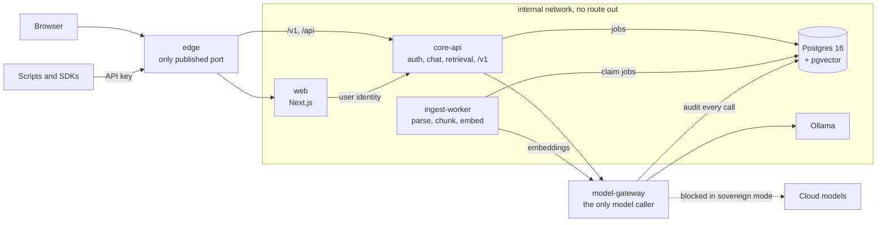

# v3 Roadmap — a secure, sovereign AI chat kit

> **Status: proposed.** Nothing here is built yet. Five decisions are open (see
> [Open decisions](#open-decisions)); work on Milestone 1 starts once they are
> settled. v2 is unreleased and its plan, [docs/v2/PLAN.md](../v2/PLAN.md),
> stays the record of what was built through Phase 4.

## Vision

LLM Dev Kit v3 is a **security- and sovereignty-focused, local-first AI chat
kit** that any organisation can run on its own machine or network with Docker,
using its own models. Nothing leaves the network unless an administrator allows
it, every request is authenticated and attributed, and every model call is
audited.

It is also a **learning project**: each layer should be understandable on its
own, so clarity beats cleverness. Every milestone step ends with a short
explanation of the concept it teaches.

## Architecture decisions

These are fixed for v3. The right-hand column says what changes from today.

| # | Decision | Change from today |
| --- | --- | --- |
| 1 | **Postgres 16 + pgvector is the single system of record**: users, workspaces, chats, documents, chunks, jobs and the audit log. Redis becomes optional. | ChromaDB and SQLite leave the default stack. (Qdrant and Kafka were already removed in v2.) |
| 2 | **Background jobs run on a Postgres-backed queue** (`SELECT … FOR UPDATE SKIP LOCKED`) behind a `JobQueue` port. | Ingestion moves out of the HTTP request. No Kafka. |
| 3 | **Five services.** `edge` (nginx or Caddy) is the only published port. `web` stays Next.js, on Postgres. `core-api` replaces rag-service. `model-gateway` replaces llm-service and is the only service that may call a model. `ingest-worker` runs one pipeline for every source. | rag-service and llm-service are merged or renamed; ingest-worker is new. |
| 4 | **Every API route requires authentication**, `/v1` included. GitHub webhooks use an HMAC signature only. Every request resolves to *(user, workspace, scopes)* before any work. | Authentication exists since v2 Phase 4. Workspaces and per-workspace scopes are new. |
| 5 | **Tenancy by workspace.** Every document, chunk and conversation belongs to one, and retrieval filters by `workspace_id` in the SQL `WHERE` clause, never afterwards in Python. | Today the document index is shared by every user. |
| 6 | **Egress isolation.** Every container sits on an `internal: true` network except model-gateway. With `SOVEREIGN_MODE=true`, model-gateway refuses every non-local model and makes no outbound calls. | New. Sovereign mode was planned as v2 Phase 3. |
| 7 | **Ports and adapters** in every Python service: `api/` (parse → authorize → delegate → serialise), `domain/` (pure, no I/O), `services/`, `ports/`, `adapters/`, `config.py`. | Extends the v2 `ldk_core` ports and plugin registry instead of replacing them. |
| 8 | **One streaming protocol (SSE), one error envelope, `X-Request-Id` on every hop.** | The envelope and request ids exist already. Internal streams move from NDJSON to SSE. |

### Target shape

## Milestone 1 — Secure core

The smallest stack that is secure, tenant-isolated and sovereign end to end.

### Scope

1. **Schema.** Postgres + pgvector, with Alembic migrations for these tables:
   - `workspaces`, `users`, and `memberships` (role: owner | editor | reader);
   - `api_keys` (prefix, hash, scopes, expires_at, revoked_at);
   - `documents` (workspace_id, source_type, source_uri, content_hash, status);
   - `chunks` (document_id, workspace_id, ord, text, tsv, `embedding vector(768)`,
     embed_model, metadata jsonb);
   - `ingestion_jobs` (state, attempts, run_after, last_error);
   - `conversations`, and `messages` (parent_id, retrieved_chunk_ids, tokens_in,
     tokens_out);
   - `audit_events` (actor, workspace_id, action, resource, model, egress).
2. **core-api.**
   - API keys stored as a prefix plus a hash, never in plaintext.
   - `POST/GET/DELETE /api/v1/workspaces/{id}/api-keys`, `POST /api/v1/documents`
     (upload) and `GET /api/v1/documents`.
   - `/v1/models` and `/v1/chat/completions`, streaming over SSE.
   - **Hybrid retrieval:** the pgvector cosine top-k and the Postgres full-text
     top-k, fused with Reciprocal Rank Fusion. Every answer returns its sources.
3. **ingest-worker.**
   - Extracts PDF text (the current extractor, behind a `Parser` port), chunks
     it, and embeds the chunks through model-gateway.
   - Replaces a document's chunks atomically, in **one** transaction.
   - Idempotent on `content_hash`.
   - Retries with backoff, then marks the job `failed`.
4. **model-gateway.** Keeps today's Ollama and LiteLLM routing, adds
   `SOVEREIGN_MODE` enforcement, and writes an audit event for every model call,
   recording whether it left the network.
5. **web.** Prisma moves to Postgres. The chat provider calls core-api `/v1`
   with a service credential plus the signed-in user's identity. No UI redesign.
6. **Compose.**
   - A `lite` profile (edge, web, core-api, model-gateway, ingest-worker,
     postgres, ollama), started with `docker compose --profile lite up`.
   - Secrets come from Docker secrets files, not environment variables.
   - Every service runs non-root, on a read-only root filesystem, with a
     healthcheck.
7. **Docs.**
   - ARCHITECTURE.md rewritten for v3, with Mermaid diagrams.
   - ADRs: `0001-postgres-over-qdrant-chroma-kafka`, `0002-auth-at-edge-and-core-api`
     and `0003-egress-isolation`.
   - Remove the drift: no Streamlit or static-UI mentions.

### Build order

Each step ends with a pause for review and a short explanation of what it
teaches.

| Step | Builds | Concept it teaches |
| --- | --- | --- |
| a | Schema and migrations | pgvector indexes (HNSW), generated `tsvector` columns, least-privilege database roles |
| b | Authentication and API keys | Resolving every request to *(user, workspace, scopes)*; hashing secrets |
| c | Ingestion | `FOR UPDATE SKIP LOCKED`, idempotency, atomic replace in one transaction |
| d | Retrieval and chat | Hybrid search and Reciprocal Rank Fusion; citations |
| e | model-gateway sovereignty | Egress by construction, not by policy; audit trails |
| f | Web integration | Moving Prisma from SQLite to Postgres; acting on a user's behalf |
| g | Compose, CI and docs | Docker secrets, read-only filesystems, image scanning, SBOMs |

### Definition of done

- **Mandatory tests**, against a real Postgres via testcontainers:
  - a user in workspace A can never retrieve workspace B's chunks;
  - every unauthenticated request to `/v1` and `/api/*` returns 401;
  - `SOVEREIGN_MODE=true` blocks a cloud model request and records no egress;
  - re-ingesting the same file creates no duplicate chunks;
  - a failed job retries, then lands in `failed` with `last_error` set.
- Unit tests for domain logic and services.
- Web: `npm run typecheck && npm run lint && npm run build` pass.
- CI: lint, tests, a Trivy image scan that fails on HIGH or CRITICAL, and an SBOM
  from Syft.
- **End to end, from a fresh clone:** `docker compose --profile lite up`, create
  an account, upload a PDF, ask a question and get an answer with citations,
  with no outbound network calls in sovereign mode.

### New dependencies (each justified)

| Package | Why |
| --- | --- |
| `psycopg[binary,pool]` 3 | The standard library has no Postgres driver. Queries stay plain SQL, so SKIP LOCKED and RRF are readable. |
| `alembic` (brings SQLAlchemy core) | Schema migrations, as decided. |
| `testcontainers[postgres]` (development only) | Integration tests against a real Postgres. |
| `argon2-cffi` | Only if decision 2 keeps argon2. |

No pgvector Python package (vectors are passed as SQL literals) and no queue
library (the queue is plain SQL).

## Open decisions

These need an answer before Milestone 1 starts. Each has a recommendation.

| # | Question | Recommendation |
| --- | --- | --- |
| 1 | **Who owns which tables?** Prisma already owns users, sessions, chats, messages and API keys. | One database, two schemas. Prisma owns identity and chat history in `app`, and Alembic owns everything new in `core`. core-api's `messages` records each answer's provenance rather than a second copy of the history. |
| 2 | **Identity, and how API keys are hashed.** | Keep the web app as the token issuer (v2 Phase 4). Move workspace-scoped API keys to core-api, hashed with HMAC-SHA-256 and a server-side pepper. argon2 protects low-entropy passwords; for random 256-bit keys it adds a slow verification to every request and a dependency, and protects nothing extra. |
| 3 | **Where Ollama runs in `lite`.** An `internal: true` network also cuts off the host, so model-gateway cannot reach a host Ollama from it. | Ollama as a container on the internal network: sovereign by construction, but CPU-only on macOS. Document host Ollama as a faster mode where sovereignty is enforced only in code. Either way, refuse Ollama's `-cloud` models in sovereign mode: those leave the machine through Ollama itself. |
| 4 | **Existing data.** | Ship a one-shot SQLite → Postgres script for accounts and chats, and re-ingest documents (the Chroma index is not migrated). |
| 5 | **v3 and the v2 plan.** | v3 supersedes the open v2 phases: sovereign mode (#13), per-user ingestion (#15) and limits and audit (#16) fold into Milestones 1–3 and are relabelled. Tag the current `main` as `v2-archive` locally; it does not match the `v*.*.*` publish pattern. |

Two smaller adjustments: Trivy should run with `--ignore-unfixed`, or CI fails on
day one from CVEs in the stock base images that have no fix yet. And moving
internal streams to SSE changes `/api/rag/chat/stream` from NDJSON, which goes in
MIGRATION.md.

## Later milestones (proposed)

Out of scope for Milestone 1, in a suggested order. Each becomes its own plan
when its turn comes.

### Milestone 2 — Better ingestion
- Docling for layout-aware parsing, with OCR for scanned PDFs, behind the
  `Parser` port.
- The GitHub connector, rewritten: HMAC-signed webhooks feeding the same
  ingestion pipeline.
- A reranker after hybrid retrieval.
- Object storage (MinIO, or S3 in the cloud) for original files, so documents
  can be re-indexed.
- More loaders: text and Markdown (#29).

### Milestone 3 — Operate at scale
- Rate limits per user and per IP, done properly (#16; fixes #28).
- An `observability` profile: OpenTelemetry, Prometheus, Grafana, with the
  audit log visible to admins.
- An optional Redis cache.
- An optional Kafka adapter behind the `JobQueue` port, for high-volume
  ingestion.
- Published, multi-arch images and faster start-up (#19, #38).
- Kubernetes and Helm (#41), cloud deployment guides (#42), and an end-to-end CI
  test of the full stack (#43).

### Milestone 4 — Organisation-ready
- Single sign-on with any OIDC provider, building on the existing Keycloak
  profile (#40, #30).
- Workspace administration in the admin page (#17).
- Branding: name, logo, assistant name (#39).
- Retention policies, log rotation, backups, restore and wipe (#44, #13).
- `PRIVACY.md` and a data-flow statement per profile.

### Milestone 5 — Assistants
- Agents with tool calling, through the existing MCP tools.
- Long-term memory.
- Voice.
- Multimodal input.

## Existing issues and where they land

| Issue | Lands in |
| --- | --- |
| #35 batch embeddings, #37 one RAG pipeline | Solved by Milestone 1 (ingest-worker and core-api) |
| #36 race conditions | Chroma part removed with Chroma; JWKS part still applies (Milestone 1, step b) |
| #31 web health endpoint, #32 MCP client reuse, #33 CONTRIBUTING, #34 cloud model badge | Independent, good first issues, any time |
| #28 rate-limit header | Good first issue now; replaced by Milestone 3 rate limits |
| #13, #15, #16 | Folded into Milestones 1–3 once decision 5 is settled |
| #19, #38, #41, #42, #43 | Milestone 3 |
| #17, #30, #39, #40, #44 | Milestone 4 |

## How we work

- One milestone step at a time, paused for review, with small commits and
  Conventional Commit titles.
- No new dependency without a one-line justification; prefer the standard
  library.
- Never commit secrets, real keys or `.env` files.
- If a decision here turns out to be wrong, say so before building on it.
